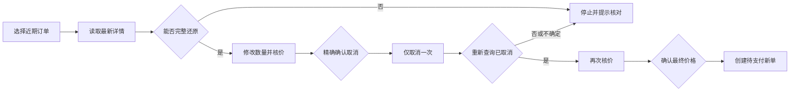

<p align="center">
  
</p>

<h1 align="center">麦单回正 McUndo</h1>

<p align="center">
  <strong>给点错、点多、重复下单，一条更安全的补救路径。</strong><br />
  核对原单、调整数量、重新核价；取消和重建分别确认，任何不确定都立即停止。
</p>

<p align="center">
  
  
  
  
</p>

<p align="center"><sub>麦当劳程序员创意开发大赛独立参赛作品 · 非麦当劳官方产品</sub></p>

<p align="center">
  <a href="#先跑一次离线演示">运行演示</a> ·
  <a href="#一次回正是怎样完成的">查看流程</a> ·
  <a href="#安全机制">了解安全边界</a> ·
  <a href="#验证状态">核对验证证据</a>
</p>

---

## 补救订单，也别再错一次

McUndo 解决的不是“帮你再下一单”，而是补救过程中最容易发生的二次错误。

它基于麦当劳 MCP Server，将核对、取消、重新核价和重建编排成一条可验证的命令行补救流程。

| 🔍 看清再动 | ✋ 两次决定 | 🧯 不确定就停 |
| --- | --- | --- |
| 取消前重读最新订单，变化就停止；创建前再次核价 | 取消旧单和创建待支付新单分别确认，一次授权不能复用 | 状态、价格或网络结果说不清时，不猜测、不自动重试 |

## 什么时候用

| 你遇到的情况 | McUndo 如何处理 |
| --- | --- |
| 餐品数量手滑点错 | 基于原单已有餐品生成替代餐单，调整数量并重新核价后再决定是否取消重建 |
| 某项餐品不想要了 | 在替代餐单中将数量改为 `0`，先展示变更和新价格，再请求确认 |
| 已经确认出现重复订单 | 由你选中要处理的一单，经确认后只执行一次取消 |
| 帮多人点餐后数量对不上 | 逐项确认修改数量，避免边改边猜 |

> [!NOTE]
> McUndo 不会自动判断哪一单是重复单，也不支持随意新增餐品。当前自动重建仅覆盖可完整还原的简单到店订单；选择重建时，复杂订单会在取消前停止。

## 先跑一次离线演示

不用登录、不填 Token、不碰真实订单。克隆后直接运行合成数据演示：

```powershell
git clone https://github.com/xiaosongxiaosong1111/mcundo.git
Set-Location mcundo
npm ci
npm run demo
```

按终端提示即可走完：选择订单 → 调整数量 → 重新核价 → 分别确认取消与重建 → 创建待支付新单。修改数量时，按回车保持，输入 `0` 删除。

<p align="center">
  
</p>

<p align="center"><sub>整个演示只使用本地合成数据，不连接麦当劳服务，也不会产生真实订单。</sub></p>

## 连接自己的麦当劳账户

> [!CAUTION]
> **本仓库不会附带项目作者的真实 Token。** Token 是账户权限凭证，公开后任何人都可能读取或操作对应账户。每位使用者必须在[麦当劳 MCP 开放平台](https://open.mcd.cn/mcp)申请并使用自己的 Token。

### Windows PowerShell

先在开放平台复制 **Token 本体**，不要复制 `Bearer`。然后在项目目录执行：

```powershell
try {
  $env:MCD_MCP_TOKEN = ([string](Get-Clipboard)).Trim()
  Set-Clipboard -Value '' -ErrorAction Stop

  npm run doctor
  if ($LASTEXITCODE -ne 0) { throw '连接检查失败' }

  npm run verify:live
  if ($LASTEXITCODE -ne 0) { throw '只读订单验证失败' }

  npm start
} finally {
  Remove-Item Env:MCD_MCP_TOKEN -ErrorAction SilentlyContinue
}
```

这段命令会立即清空当前剪贴板，并在退出时删除当前终端中的环境变量。Token 不会写入项目文件、Git 历史或日志。若启用了 Windows 剪贴板历史（`Win + V`）或跨设备同步，还应手动删除其中的 Token 记录。

<details>
<summary><strong>macOS / Linux 安全输入方式</strong></summary>

```bash
read -rsp "MCD MCP Token: " MCD_MCP_TOKEN
echo
export MCD_MCP_TOKEN

npm run doctor && npm run verify:live && npm start

unset MCD_MCP_TOKEN
```

</details>

> [!IMPORTANT]
> `doctor` 只检查连接和工具；`verify:live` 只调用 `order-list` / `query-order`，不会核价、取消或创建订单。真实救援模式必须在交互终端运行，不能通过管道绕过人工确认。

## 一次回正是怎样完成的

<p align="center">
  
</p>

<p align="center"><sub>错单 → 重新核对与独立确认 → 创建待用户支付的新单；McUndo 不会自动付款。</sub></p>



流程实际调用五个 MCP 工具：

| Tool | 用途 | 写操作 |
| --- | --- | :---: |
| `order-list` | 获取近期订单，供用户选择 | 否 |
| `query-order` | 读取最新详情并验证状态 | 否 |
| `calculate-price` | 对替代餐单重新核价 | 否 |
| `cancel-order` | 精确确认后取消旧单一次 | 是 |
| `create-order` | 独立确认后创建待支付新单一次 | 是 |

完整参数边界与业务价值见 [`MCP_INTEGRATION.md`](MCP_INTEGRATION.md)。

## 安全机制

| 机制 | 保证 |
| --- | --- |
| 双重确认 | 取消旧单和创建新单分别授权，一次确认不能复用 |
| 写前复核 | 确认后再次读取订单；内容变化就让确认失效 |
| 写后验证 | 只有重新查询确认旧单已取消，才允许继续重建 |
| 最终核价 | 创建前再次核价；价格变化就要求重新确认 |
| 不确定即停止 | 取消和创建均不自动重试，避免重复写入 |
| 最少披露 | 不展示完整订单号、电话或地址；支付链接仅在创建成功时显示一次 |
| Token 不落盘 | 只从环境变量读取，配置示例仅保留占位符 |

<details>
<summary><strong>当前支持范围与限制</strong></summary>

- 自动重建仅覆盖能被现有字段完整描述的简单到店订单。
- 选择重建时，套餐、特制项、优惠券、外送、团餐、缺失或重复商品编码、列表与详情不一致会在取消前停止。
- 无法唯一还原取餐方式时不会猜测。
- “取消成功”不等于退款到账，退款和最终状态以麦当劳官方渠道为准。
- 价格、库存、可取消状态及服务能力会实时变化。
- 不要在多个终端同时处理同一订单；结果不确定时先回官方 App 核对。
- 终端可能显示完成操作所需的订单摘要及支付链接（仅显示一次），请勿截图或公开终端输出。
- 新订单只创建到待支付阶段，本项目不会自动付款。

</details>

## 验证状态

| 检查项 | 状态 | 证据 |
| --- | --- | --- |
| 自动化测试 | ✅ 通过 | 2026-10-12：71/71 单元、集成与 CLI 端到端测试通过 |
| 官方 MCP 连接与工具发现 | ✅ 通过 | 2026-10-10：连接 `https://mcp.mcd.cn`，发现 35 个工具，所需 5 个均存在 |
| `order-list` / `query-order` 真实只读链路 | ⚠️ 待近期订单验证 | 已提供不输出订单内容的 `npm run verify:live` |
| `cancel-order` / `create-order` 真实写入 | ⛔ 未执行 | 不拿真实订单做破坏性验收，也不声称线上端到端已实测 |

没有近期订单时，`verify:live` 会报告 `partial`，不会把未执行的 `query-order` 伪装成成功。

## 命令速查

| 命令 | 作用 | 需要 Token |
| --- | --- | :---: |
| `npm run demo` | 完全离线的交互演示 | 否 |
| `npm test` | 运行全部自动化测试 | 否 |
| `npm run coverage` | 测试并输出覆盖率 | 否 |
| `npm run doctor` | 检查真实 MCP 连接与工具 | 是 |
| `npm run verify:live` | 验证真实只读订单链路 | 是 |
| `npm start` | 启动真实交互救援流程 | 是 |

## 项目结构

```text
src/                    CLI、安全状态机、MCP 适配器、离线演示
test/                   单元、集成和 CLI 端到端测试
docs/assets/            README 横幅、场景图与合成演示图
SKILL.md                供 Codex 等智能体使用的安全操作规范
MCP_INTEGRATION.md      MCP 工具、调用流程与业务价值
mcp-config.example.json 脱敏 MCP 配置示例
```

## 参赛说明

本项目是麦当劳程序员创意开发大赛的独立参赛作品，不是麦当劳官方产品，也不暗示官方背书。仓库按比赛要求提供：

- [`CONTEST_DECLARATION.md`](CONTEST_DECLARATION.md)
- [`MCP_INTEGRATION.md`](MCP_INTEGRATION.md)
- [`mcp-config.example.json`](mcp-config.example.json)
- 可运行源码与测试

相关链接：

- [比赛官方仓库](https://github.com/M-China/mcd-developer-innovation-challenge)
- [活动规则](https://github.com/M-China/mcd-developer-innovation-challenge/blob/main/activityGuidelines.md)
- [麦当劳 MCP Server 文档](https://github.com/M-China/mcd-mcp-server)
- [麦当劳 MCP 开放平台](https://open.mcd.cn/mcp)

---

<p align="center">
  <strong>如果你认可“确认前不写、结果不明不重试”的处理方式，欢迎为 McUndo 点一个 Star。</strong><br />
  也欢迎通过 <a href="https://github.com/xiaosongxiaosong1111/mcundo/issues/new">Issue</a> 提交新的错单场景与安全边界。
</p>
